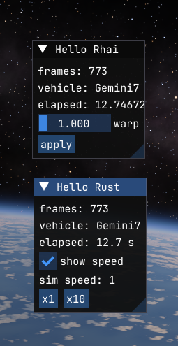

# Oxidizer

A mod loader for Kitten Space Agency, written in Rust. Mods can be written in Rust (cdylib) or as Rhai scripts. Runs on Windows and Linux.



KSA is a .NET 10 game, so the loader:
1. loads the game's own `hostfxr` (`hostfxr.dll` / `libhostfxr.so`) and starts its runtime with `KSA.dll`,
2. injects `bridge/` (a small C# DLL plus Harmony), which hooks `Program.OnFrame`, `Program.OnDrawUiViewports` and the game's menu bar, and gives mods reflection access to game objects,
3. loads the mods, then runs the game's `Main`.

In game, **Mods > Oxidizer** in the menu bar opens a window that lists the loaded mods, their errors and the log.

## Install

1. Download `Oxidizer-vX.Y.Z.zip` from [Releases](https://github.com/SafeShows/Oxidizer/releases) and unzip it anywhere. It has both the Windows and the Linux build.
2. Run `oxidizer.exe` (Linux: `./oxidizer`). If KSA isn't installed at the default path, set `game_path` in the `oxidizer.toml` it creates next to the exe. On Linux there is no default, so set it on the first run.
3. To try the examples, copy the folders from `example-mods/` into `Documents/My Games/Kitten Space Agency/mods/`.

## Build

```sh
dotnet build bridge -c Release -o target/bridge
cargo build --release --workspace
```

## Run

```sh
target/release/oxidizer.exe [--game "<KSA folder>"] [-InstancePath "<folder>"] [game args...]
```

On first run without `--game`, the loader creates `oxidizer.toml` next to the exe (`game_path = '...'`). On Windows it defaults to `C:\Program Files\Ahwoo\Games\Kitten Space Agency`; on Linux, set it yourself.

`oxidizer --bindgen ksa.rs` writes typed Rust bindings for the installed game instead of starting it (see [Typed bindings](#typed-bindings)).

`-InstancePath`, or the `OXIDIZER_INSTANCE_PATH` environment variable, makes the game use that folder instead of `Documents/My Games/Kitten Space Agency` for mods, saves and settings. Mod managers such as Borea use it for separate game profiles.

## Mods

A mod is a folder in `Documents/My Games/Kitten Space Agency/mods/<id>/` whose `mod.toml` has a `[oxidizer]` section:

```toml
name = "my_mod"

[oxidizer]
dll = "my_mod"          # Rust mod: my_mod.dll on Windows, libmy_mod.so on Linux
script = "main.rhai"    # and/or Rhai script

# Tells mod managers such as Borea which loader this mod needs.
[loader]
id = "Oxidizer"
min = "0.2.0"
```

Mods set `enabled = false` in KSA's `manifest.toml` are skipped. See `examples/` for working mods. To install one, copy its folder into `mods/`; for a Rust mod, also copy in the built library (`.dll` on Windows, `lib*.so` on Linux). A mod for both platforms can ship both files.

### Rust

The crate is a `cdylib` that depends on `oxidizer_api`. The API crate has its own version, separate from Oxidizer's: it only changes when something changes for mod authors, so `oxidizer_api = "0.3"` works with Oxidizer 0.4 and later, and `cargo update` picks up fixes. `Mod` has `init`, `frame`, `gui`, `menu` (entries in the game's Mods menu) and `unload`; all but `init` are optional.

```rust
use oxidizer_api::{Mod, Obj, imgui};
struct M;
impl Mod for M {
    fn init() -> Self { M }
    fn gui(&mut self, _dt: f64) {
        if imgui::begin("My mod") {
            let v = Obj::static_get("KSA.Program, KSA", "ControlledVehicle");
            imgui::text(&v.get("Id").to_string());
        }
        imgui::end();
    }
}
oxidizer_api::oxidizer_mod!(M);
```

Also in `oxidizer_api`:
- `hook(type, method, postfix, fn)` patches a game method; inside the hook, `hook_result()` / `set_hook_result(&v)` read and replace its return value (from a prefix, return `false` as well to skip the original).
- `key_pressed("F5")` is true on the frame a key was pressed, `key_down("F5")` while it's held. Names are the game's key names (`"K"`, `"F5"`, `"Space"`, `"LeftShift"`, ...). Keys typed into text fields or the console, or eaten by a dialog, don't count.
- `config_path("my_mod")` is where to keep your settings: `<documents>/oxidizer/my_mod.toml`, outside the mod folder so updating the mod doesn't lose them.

#### Typed bindings

Instead of member names in strings, Rust mods can use generated types with autocomplete and compile-time checks:

```sh
oxidizer --bindgen src/ksa.rs     # once, and again after each game update
```

```rust
mod ksa; // the generated file: a module per namespace, a struct per public KSA.dll type
use ksa::ksa::{Program, Universe};

let v = Program::controlled_vehicle();          // -> ksa::ksa::Vehicle
if !v.is_null() {
    oxidizer_api::log(&format!("{} at {:.0} s", v.id(), Universe::get_elapsed_seconds()));
}
Universe::set_simulation_speed_2(5.0, true);   // overloads get _2, _3, ... suffixes
```

Each wrapper derefs to its base class and finally to `Obj`, so inherited members and the by-name API work on it too. Members are called by their exact metadata token, so there's no overload guessing. The file only works with the game build it was generated from: against another build, every call does nothing after one log message telling you to regenerate it. Only public members are generated; use the by-name API for the rest.

### Rhai

A script can define `init()`, `frame(t, dt)`, `gui(dt)`, `menu()` (entries in the game's Mods menu) and `unload()`. Keep state in `this` (an object map).

Scripts reload while the game runs: save the file and the new code takes over within a second. `this` is kept, `init()` doesn't run again, and `reload()` runs if the script defines it. If the new version doesn't compile, the old one keeps running and the error shows in the Oxidizer window.

| Area | Functions |
|---|---|
| Game objects | `static_get(type, member)`, `static_set(type, member, v)`, `static_call(type, method[, args])`, `obj.get(m)`, `obj.set(m, v)`, `obj.call(m[, args])`, `obj.float()`, `obj.is_null()`, `obj.len()`, `obj[i]`, `obj.to_string()` |
| Patching | `patch(type, method, "prefix"\|"postfix", "fn_name")`. The callback is `fn_name(instance, args)`; returning `false` from a prefix skips the original method. |
| ImGui | `begin(title)` / `end()`, `text`, `button`, `checkbox(label, v) -> v`, `slider(label, v, min, max) -> v`, `same_line`, `separator`, `header` |
| Menu (in `menu()`) | `menu_item(label[, checked]) -> clicked`, `begin_menu(label)` / `end_menu()` for a submenu |
| Return values (in a hook) | `result()`, `set_result(v)`: read or replace the hooked method's return value |
| Keys | `key_pressed(name)` (this frame), `key_down(name)` (held), e.g. `key_pressed("F5")` |
| Settings | `config_get(key, default)`, `config_set(key, value)` for bools, numbers and strings, saved to `<documents>/oxidizer/<mod>.toml` |
| Logging | `print(...)` |

## Notes and limits

- Members are looked up by name through reflection. Type names can be assembly-qualified (`"KSA.Universe, KSA"`), which works even before the game has loaded that type.
- `call` picks the first overload with a matching argument count and converts arguments to the parameter types.
- Patching uses the first overload of the method. Hooks receive the instance and the arguments, and can read and replace the return value.
- A Rhai hook doesn't run while another Rhai script is running (they share one script engine): if a script calls a method another script hooks, the call goes through unhooked. Calls from the game and from Rust mods are always hooked.
- A Rhai script that throws an error stops until its file is saved again, so the same error isn't logged every frame. Errors from reflection calls are logged once each.
- `ref struct` members (for example `ReadOnlySpan` properties such as `Program.VehiclesInFrame`) can't be read through reflection.
