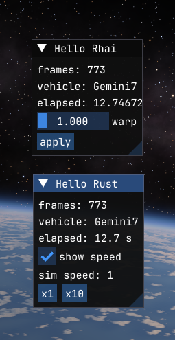

# Introduction

[Oxidizer](https://github.com/SafeShows/Oxidizer) is a mod loader for [Kitten Space Agency](https://ksa.ahwoo.com). It runs code mods written in two languages, so you don't need C#:

- **Rhai**, a scripting language that looks like a simpler Rust. A Rhai mod is a text file: no compiler, no build step, and it reloads while the game runs when you save it. Start here if you're new to modding.
- **Rust**, compiled to a native library. Rust mods are fast, checked by the compiler, and can use any crate.

Both kinds of mod can:

- run code every frame,
- draw their own windows with the game's ImGui, and add entries to the game's **Mods** menu,
- read and change anything in the game: the vehicle you fly, the universe's time and warp, every game object,
- patch game methods: run code before or after them, skip them, or change what they return,
- react to hotkeys and keep their own settings.

## How this guide is organized

- [Getting started](install.md): install Oxidizer and learn where mods live.
- [Rhai mods](rhai/first-mod.md) and [Rust mods](rust/first-mod.md): each starts with a working mod and then covers one topic per page. They mirror each other, so you can read just the one you need.
- [Sharing your mod](publishing/releases.md): releases and the KSA content index, so players can install your mod with a mod manager.

## Quick links

| | Rhai | Rust |
|---|---|---|
| Template | [oxidizer-rhai-mod-template](https://github.com/SafeShows/oxidizer-rhai-mod-template) | [oxidizer-rust-mod-template](https://github.com/SafeShows/oxidizer-rust-mod-template) |
| Example | [hello_rhai](https://github.com/SafeShows/Oxidizer/tree/master/examples/hello_rhai) | [hello_rust](https://github.com/SafeShows/Oxidizer/tree/master/examples/hello_rust), [Flight Panel](https://github.com/SafeShows/oxidizer-flight-panel) |
| Editor | [Rhai Studio](https://github.com/SafeShows/oxidizer-rhai-studio) (in game) | any Rust editor |
| API docs | [Rhai on the README](https://github.com/SafeShows/Oxidizer#rhai) | [docs.rs/oxidizer_api](https://docs.rs/oxidizer_api) |
