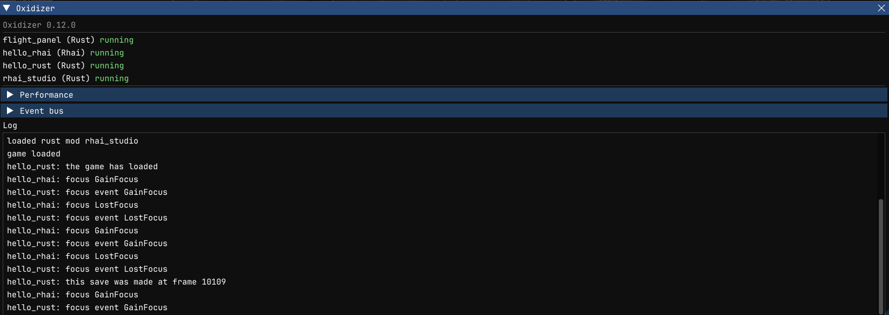

# Keys and settings

## Keys

```rust
fn frame(t, dt) {
    if key_pressed("F8") {          // true only on the frame the key went down
        this.visible = !this.visible;
    }
    if key_down("LeftShift") {      // true while the key is held
        // ...
    }
}
```

Key names are the game's (GLFW's): `"A"` to `"Z"`, `"Number0"` to `"Number9"`, `"F1"` to `"F25"`, `"Kp0"` to `"Kp9"` (keypad), `"Space"`, `"Enter"`, `"Escape"`, `"Tab"`, `"Backspace"`, `"Up"`, `"Down"`, `"Left"`, `"Right"`, `"LeftShift"`, `"LeftControl"`, `"LeftAlt"` (and `Right...`), `"Comma"`, `"Period"`, `"Minus"`, `"Equal"`, and so on. Keys typed into a text field or the game's console, or caught by a dialog, don't count, so a hotkey doesn't fire while the player types.

Pick keys the game doesn't use, and tell players about them (in a `print` at `init`, your menu entry's label, or your mod's description).

## Settings

`config_set` saves a value for your mod; `config_get` reads it back, with a default for the first run:

```rust
fn init() {
    this.visible = config_get("visible", true);
    this.warp = config_get("warp", 1.0);
}

fn menu() {
    if menu_item("My mod", this.visible) {
        this.visible = !this.visible;
        config_set("visible", this.visible);
    }
}
```

Values can be bools, integers, floats and strings. They are written to `<game documents>/oxidizer/<mod id>.toml` at most once a second and when the game closes. That file is outside your mod's folder, so updating the mod keeps them.

## Data per save game

Settings are the same in every game. For what belongs to one game (missions done, a colony's stock, where a probe was sent), keep it with the player's save (Oxidizer 0.12 and later):

```rust
fn saving() {
    // The game is about to write a save: put in what this save should remember.
    save_set("missions_done", this.missions_done);
}

fn save_loaded() {
    // The game loaded a save: read it back.
    this.missions_done = save_get("missions_done", 0);
}
```

Values are numbers, strings, bools, arrays and maps. They are written into the save's own folder (`saves/<save>/oxidizer/<mod>.json`), so they travel with the save. A save from before your mod, or a new game, has none: `save_get` gives the default.


