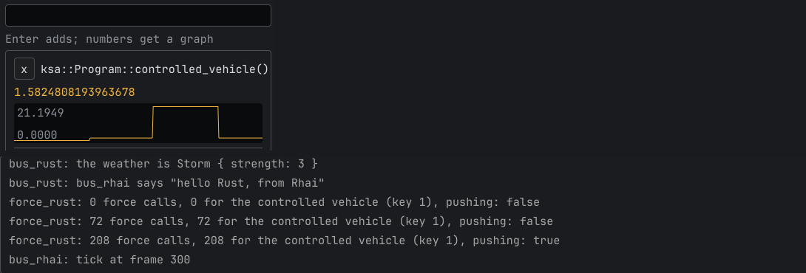

# Physics forces

A Rust mod can add forces and torques to vehicles inside the game's physics: aerodynamics, wind, magnetic torquers,
anything the game doesn't model. Oxidizer 0.12 and later (`oxidizer_api` 0.7).

```rust
use oxidizer_api::physics::{self, ForceInput, ForceOutput};

fn init() -> Self {
    physics::register_force(lift); // once
    MyMod {}
}

fn lift(input: &ForceInput, out: &mut ForceOutput) -> bool {
    if input.density == 0.0 {
        return false; // above the atmosphere: nothing to add
    }
    out.force = [0.0, 0.0, 0.5 * input.density * 20.0]; // body axes, newtons
    true
}
```

The callback runs once or more per physics substep for every vehicle in full physics: vehicles flying, coasting
in an atmosphere, or splashed down. Vehicles on rails (orbit above the atmosphere) and landed ones have no substeps.
What it returns is added after the game's own forces: gravity, drag, buoyancy, engines and parachutes.

## What the callback gets

[`ForceInput`](https://docs.rs/oxidizer_api/latest/oxidizer_api/physics/struct.ForceInput.html) holds the
vehicle's state at that moment, in SI units:

- `vehicle`: a key for the vehicle. [`physics::vehicle_key(&vehicle)`](https://docs.rs/oxidizer_api/latest/oxidizer_api/physics/fn.vehicle_key.html)
  gives the same key for a `KSA.Vehicle` on the game's thread, so `frame` can tell the callback what to do per vehicle.
- `position`, `velocity`, `angular_velocity`, `body_to_bub`: in the game's physics frame, centered on the parent
  body. `frame` says which axes: 0 for inertial (CCI), 1 for rotating with the body (CCF, used near bodies; there
  `velocity` is already the velocity relative to the air).
- `density`, `pressure`, `temperature`, `speed_of_sound`: the game's atmosphere at the vehicle, 0 above it.
- `mass`, `center_of_mass`, `bounding_sphere_radius`, `surface_area`, `volume`, and the game's own drag areas
  `stock_cda_positive` / `stock_cda_negative` (to replace the game's drag rather than add to it).

Forces and torques you return are in body axes (the vehicle's assembly axes), about the center of mass.

## Rules for the callback

It runs on the game's physics worker threads, several vehicles at the same time, and one vehicle's substeps move
between threads. So:

- Use only what is in `ForceInput` and your own data. Don't call into the game from it: no `Obj`, no logging.
- Keep per-vehicle state keyed by `input.vehicle` (behind a lock or in atomics), never in thread-locals.
- Keep it fast: it runs inside the game's physics step. Its time shows under your mod in **Mods > Oxidizer >
  Performance**.
- A panic in it is caught and counts as no force.

A reload of the mod removes its callbacks; `init` registers them again.

[`examples/force_rust`](https://github.com/SafeShows/Oxidizer/tree/master/examples/force_rust) pushes the
controlled vehicle while F8 is held. Below, a Rhai Studio watch on the vehicle's acceleration jumps by 2 g while
F8 is held, and the example's log counts the callback's calls:



